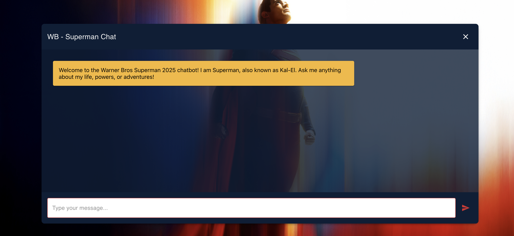

# AI Chatbot - Warner Bros Superman

An interactive AI-powered Superman-themed chatbot built with React, Material-UI, Node.js, and OpenAI API for engaging, context-aware conversations about the iconic DC superhero.



---

## 📋 Description

This project is a **Centennial College** initiative designed to create an interactive AI-powered chatbot themed around the iconic DC superhero, Superman. Developed using cutting-edge web technologies and OpenAI's API, this chatbot offers engaging, context-aware conversations, providing users with a fun and immersive experience in the world of Superman.

The application features a modern, responsive frontend built with React and Material-UI, and a robust backend powered by Node.js and Express that integrates with OpenAI's Assistant API to deliver intelligent, context-aware responses.

---

## ✨ Key Features

- **AI-Powered Conversations**: Leveraging OpenAI's Assistant API for realistic, contextually accurate dialogues that reflect Superman's persona
- **React Frontend**: A responsive and interactive UI built with React for seamless user interactions
- **Material-UI (MUI)**: Modern, visually appealing UI components styled to match Superman's iconic theme
- **Node.js with Express Backend**: A robust backend setup for managing API calls and chatbot interactions
- **Custom Theming**: Superman-inspired UI, featuring his legendary colors (blue, red, yellow) and symbols
- **Dynamic Responses**: Capable of answering a range of questions, from Superman lore to general AI-based queries
- **Thread-based Conversations**: Maintains conversation context using OpenAI's thread system

---

## 🛠️ Technologies Used

### Frontend
- **React.js** (v19.0.0): For a dynamic and interactive frontend
- **Material-UI (MUI)** (v6.3.1): For crafting a sleek and polished design
- **React Scripts** (v5.0.1): Build tooling for React applications

### Backend
- **Node.js**: JavaScript runtime environment
- **Express.js** (v4.21.2): Web framework for Node.js
- **OpenAI API** (v4.77.4): For generating intelligent and natural chatbot responses
- **CORS** (v2.8.5): Cross-origin resource sharing middleware
- **dotenv** (v16.4.7): Environment variable management

---

## 📁 Project Structure

```
AI_chatbot_WarnerBros_SuperMan/
├── client/                 # React frontend application
│   ├── public/            # Static assets
│   ├── src/
│   │   ├── components/    # React components
│   │   │   └── Chatbot.js # Main chatbot component
│   │   ├── assets/        # Images and other assets
│   │   ├── App.js         # Main App component
│   │   └── index.js       # Entry point
│   ├── .env.model         # Environment variables template
│   └── package.json
├── server/                # Node.js backend application
│   ├── index.js           # Express server and API routes
│   ├── .env.model         # Environment variables template
│   └── package.json
├── docs/                  # Documentation and resources
│   ├── cleaningDatabase.ipynb
│   └── dbAboutSuperman.docx
├── LICENSE
└── README.md
```

---

## 🚀 Installation Instructions

### Prerequisites

- Node.js (v14 or higher)
- npm or yarn
- OpenAI API key
- OpenAI Assistant ID

### Step 1: Clone the Repository

```bash
git clone https://github.com/yourusername/AI_chatbot_WarnerBros_SuperMan.git
cd AI_chatbot_WarnerBros_SuperMan
```

### Step 2: Install Frontend Dependencies

```bash
cd client
npm install
```

### Step 3: Install Backend Dependencies

```bash
cd ../server
npm install
```

### Step 4: Set Up Environment Variables

#### Backend Environment Variables

Copy the `.env.model` file to `.env` in the `server/` directory and fill in your values:

```bash
cd server
cp .env.model .env
```

Then edit the `.env` file with your actual values:

```env
OPENAI_API_KEY=your_openai_api_key_here
ASSISTANT_ID=your_openai_assistant_id_here
FRONTEND_URL=http://localhost:3000
```

#### Frontend Environment Variables

Copy the `.env.model` file to `.env` in the `client/` directory and fill in your values:

```bash
cd client
cp .env.model .env
```

Then edit the `.env` file with your actual values:

```env
REACT_APP_BACKEND_URL=http://localhost:5000
```

**Note**: The `.env.model` files serve as templates. Copy them to `.env` and replace the placeholder values with your actual configuration.

---

## 🏃 Running the Application

### Running the Backend Server

```bash
cd server
npm start
```

The backend server will run on `http://localhost:5000`

### Running the Frontend Development Server

```bash
cd client
npm start
```

The frontend application will open in your browser at `http://localhost:3000`

**Note**: Make sure the backend server is running before starting the frontend to ensure proper API connectivity.

---

## 🔧 Configuration

### OpenAI Assistant Setup

1. Create an OpenAI account and obtain an API key
2. Create an Assistant in the OpenAI dashboard with appropriate instructions for the Superman character
3. Copy the Assistant ID and add it to your `.env` file

### CORS Configuration

The backend is configured to accept requests from the frontend URL specified in `FRONTEND_URL`. Update this in your `.env` file if deploying to a different domain.

---

## 📝 API Endpoints

### POST `/threads`

Creates a new conversation thread and processes user messages using OpenAI's Assistant API.

**Request Body:**
```json
{
  "messages": "user message here"
}
```

**Response:**
```json
{
  "thread_id": "thread_xxx",
  "run_id": "run_xxx",
  "messages": [...]
}
```

### POST `/completions`

Legacy endpoint for OpenAI chat completions (alternative implementation).

---

## 🎨 UI Features

- **Superman-themed Design**: Custom color scheme inspired by Superman's iconic colors
- **Responsive Layout**: Works seamlessly on desktop and mobile devices
- **Real-time Chat**: Instant message delivery and response updates
- **Loading States**: Visual feedback during API requests
- **Auto-scroll**: Automatically scrolls to the latest message
- **Welcome Message**: Greeting message when the chat loads

---

## 🔮 Future Enhancements

- **Voice Interaction**: Add support for voice input/output for a hands-free experience
- **Enhanced Knowledge Base**: Expand the chatbot's capabilities to include more DC lore and other Warner Bros. franchises
- **Multilingual Support**: Enable conversations in multiple languages for global audiences
- **Mobile App**: Adapt the chatbot for mobile platforms with React Native or other frameworks
- **User Authentication**: Add user accounts and conversation history
- **File Uploads**: Allow users to share images or documents in conversations
- **Customizable Themes**: Let users choose different superhero themes

---

## 🤝 Contributing

Contributions are welcome! Please feel free to submit a Pull Request.

1. Fork the repository
2. Create your feature branch (`git checkout -b feature/AmazingFeature`)
3. Commit your changes (`git commit -m 'Add some AmazingFeature'`)
4. Push to the branch (`git push origin feature/AmazingFeature`)
5. Open a Pull Request

---

## 📄 License

This project is licensed under the MIT License. See the [LICENSE](LICENSE) file for details.

---

## 👥 Credits

- **Institution**: Centennial College
- **Theme**: Warner Bros. Superman
- **Technologies**: React, Material-UI, Node.js, Express, OpenAI API

---

## 📞 Support

For issues, questions, or contributions, please open an issue on the GitHub repository.

---

**Built with ❤️ for Superman fans everywhere!** 🦸‍♂️
